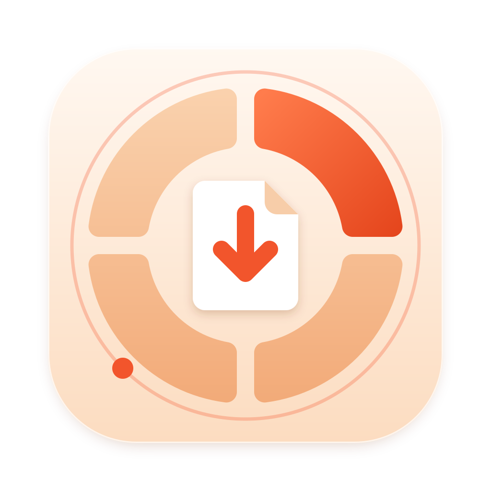
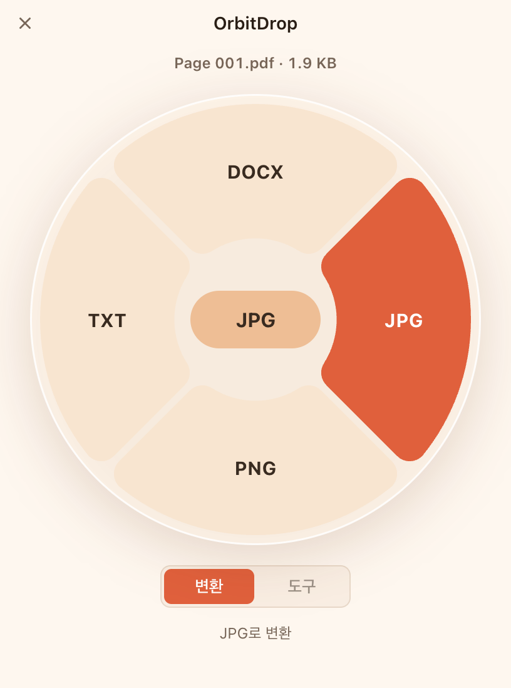
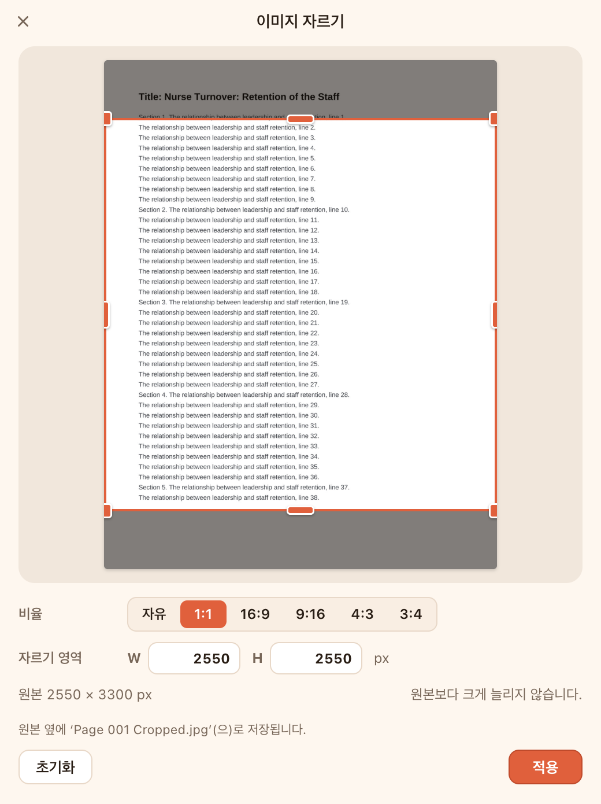
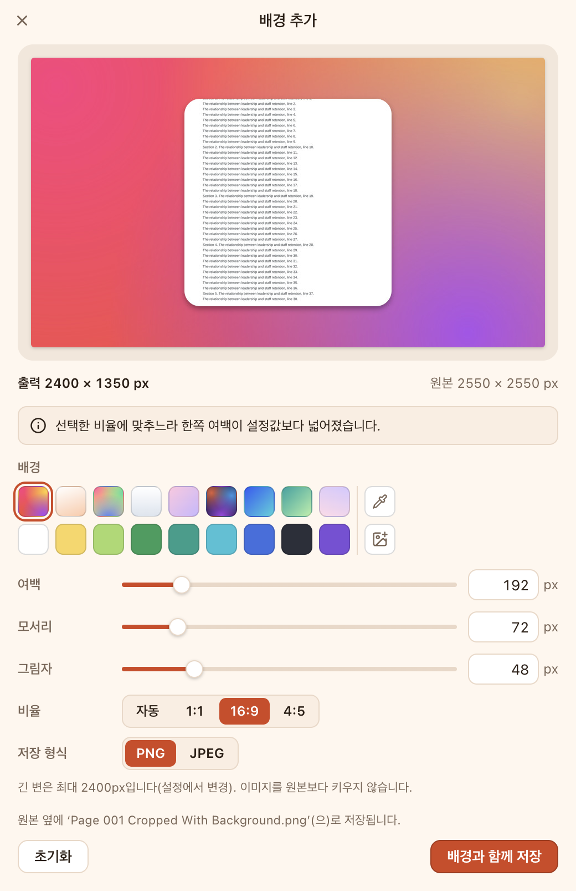
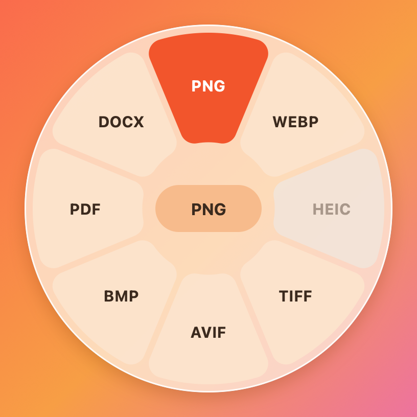

# OrbitDrop

**파일을 드래그하고 → 보조키를 누르면 → 커서 옆에 원형 메뉴가 나타나고 → 형식이나 도구 위에 놓으면 →
원본 옆에 결과 파일이 생기는** 로컬 파일 변환·편집 데스크톱 앱입니다(Windows 11 x64, macOS 14+).
모든 처리는 내 컴퓨터에서만 일어나며 원본은 이동·덮어쓰기·삭제되지 않습니다.

> A local file converter/editor: drag a file in Finder or Explorer, hold Shift, drop it on a ring
> sector (JPG, PNG, CROP, ADD BG, …) and the result is written next to the original.
> "OrbitDrop" is a working name. It is an independent app inspired by a workflow seen in a
> reference video of another product; it uses its own name, icon and code.

<p align="center"></p>

## 상태 (2026-10-24)

**개발 중.** 기능별·OS별 상태는 [docs/support-matrix.md](docs/support-matrix.md)가 기준입니다.

| 영역 | 상태 |
|---|---|
| macOS 패키지 (arm64, x64) | dmg/zip 생성, helper·sharp/libvips·@napi-rs/canvas가 대상 아키텍처로 포함, ad-hoc 서명, DMG 안의 앱으로 smoke test(helper `ready`, PNG→JPEG, PDF→PNG, 숨긴 창 렌더링) **자동 검증됨**(개발 Mac, x64는 Rosetta 2). 코드 서명·공증 자격 증명 없음 → **미서명** 산출물. 최신 패키지의 해시: [verification.md](docs/verification.md#패키징-macos-이-저장소의-개발-mac). 예전 0.1.0 패키지(소스 d4f6d1e: 빈 창, 7faf031: 보호 폴더 권한 대화상자)는 쓰지 않는다 |
| Windows 패키지 (x64) | NSIS 사용자별 설치 프로그램 설정·CI(빌드, smoke, 무인 설치/제거) 작성, **아직 Windows에서 실행되지 않음** |
| 실제 Finder/Explorer 전역 드래그 | 네이티브 helper 구현됨(macOS는 권한 없이 동작하는 관찰 방식). macOS는 **가상 머신에서 실제 Finder로 검증**(macOS 14.8.7 전 기능, 26.6.2 핵심 흐름, x64는 Rosetta 2) — 실물 Mac에서 사람이 하는 확인과 Windows는 아직 · [verification.md](docs/verification.md) |
| 변환·편집 엔진 | sharp(libvips), PDF.js + @napi-rs/canvas, pdf-lib, docx — 패키지 안에서 엔진 probe와 PNG→JPG 작업 파이프라인 확인 |

미서명 빌드는 로컬 테스트용이며 파일 이름에 `-unsigned`가 붙습니다. Gatekeeper/SmartScreen을 끄는 방법은
안내하지 않습니다([docs/packaging.md](docs/packaging.md)).

## 기능

| 등급 | 기능 |
|---|---|
| **P0** | PDF → JPG/PNG(1쪽은 같은 이름, 여러 쪽은 `report-p001.jpg`…, 300/150 DPI) · JPG/PNG/WebP 상호 변환 · **Crop** 편집기(Free, 1:1, 16:9, 9:16, 4:3, 3:4, 픽셀 W/H) · **Add Background** 편집기(프리셋/단색/이미지 배경, Padding·Corners·Shadow, Auto/1:1/16:9/4:5, 기본 PNG) · 트레이/메뉴 막대, 설정, 작업 진행·취소·결과 위치 열기 · 대체 입력(파일 열기, Drop Zone) · 네이티브 전역 드래그 |
| **P1** | Compress · Metadata(읽기/제거) · Edit(회전·반전·밝기·대비·채도) · Annotate(텍스트·화살표·사각형, 한글) · Redact(가림·모자이크) · TIFF/AVIF · 이미지 → PDF · 텍스트 PDF → TXT · 여러 파일 제한 병렬 처리 |
| **P2** | HEIC/BMP(플랫폼 코덱이 지원하는 방향만) · PDF/이미지 → DOCX(텍스트 중심) |

| 형식 선택(PDF) | 자르기 | 배경 추가 | macOS helper 휠 |
|---|---|---|---|
|  |  |  |  |

앞의 세 장은 실제 Electron 앱 창, 마지막은 macOS helper의 휠 렌더링 스냅샷입니다(실제 Finder 드래그 검증 기록이 아님).

번들 엔진이 실제로 지원하지 않는 메뉴는 사유와 함께 비활성화됩니다. 확장자만 바꾸는 "변환"은 없습니다.
기본 조작: 드래그 중 **Shift** = 변환 휠, **Option+Shift**(macOS) / **Ctrl+Shift**(Windows) = 도구 휠(설정에서 변경 가능).
Windows에서 Alt+Shift는 입력 언어 전환 단축키와 겹쳐 기본값으로 쓰지 않습니다([ADR-12](docs/decisions.md#adr-12-windows-도구-휠-기본-조합-ctrlshift)).
관찰된 사실과 제품 결정의 구분: [docs/requirements.md](docs/requirements.md).

## 처음 실행 · 도움말 · 개인정보

* **처음 실행**: 설정 파일이 아직 없으면 환영 창이 한 번 열립니다. 지금 설정된 키를 이 OS의 키 이름(macOS는 Option, Windows는
  Alt·Ctrl)으로 보여 주고, 앱이 있는 곳(메뉴 막대 / 알림 영역 — Windows 11은 새 아이콘을 ^ 안에 숨길 수 있음), Drop Zone 열기,
  "로그인 시 실행" 스위치(직접 켜기 전에는 꺼짐)를 안내합니다. 메뉴의 도움말 › 사용법으로 다시 열 수 있습니다. UI 언어는 OS 언어를
  따릅니다(한국어 → 한국어, 그 밖 → 영어). 이미 있는 설정 파일의 언어는 바꾸지 않습니다. macOS에서 디스크 이미지나 다운로드 폴더에서
  실행하면 응용 프로그램 폴더로 옮길지 한 번 묻습니다(이동 / 나중에).
* **도움말**(메뉴 막대 / 알림 영역 메뉴): 사용법 · OrbitDrop 웹사이트 · 문제 신고(GitHub 새 이슈, 앱 버전·OS 버전·아키텍처만 미리
  채우고 파일 이름·경로는 넣지 않음) · 로그 폴더 열기. 정보 창의 **진단 정보 복사**는 버전·빌드·OS·아키텍처·드래그 도우미 상태·엔진
  요약과 경로를 다시 가린 최근 로그 200줄을 클립보드에 복사합니다. 설정 › 일반에는 데이터 폴더 열기와 설정 초기화가 있습니다.
* **개인정보**: 파일은 이 컴퓨터 밖으로 나가지 않습니다. 계정과 텔레메트리가 없습니다. 업데이트 확인은 켠 경우에만 GitHub에 앱 버전만
  보냅니다. 충돌 보고서(crash dump)는 앱 데이터 폴더의 `Crashpad`에만 저장되고 업로드하지 않습니다. 작업 기록(`history.json`)은 최근
  파일 이름을 이 컴퓨터에만 보관하며 작업 창의 "끝난 작업 지우기"로 지울 수 있습니다.

## 요구 사항

* 사용: **macOS 14 이상**(Apple Silicon; Intel x64 산출물은 Intel 실기 미검증) · **Windows 11 x64**(사용자별 설치, 관리자 권한 불필요).
  Electron 44 자체는 macOS 13+, Windows 10+를 지원하지만 OrbitDrop의 검증 대상은 위와 같습니다([ADR-10](docs/decisions.md#adr-10-최소-os-버전)).
* 개발: Node.js 22.12+(24 권장), pnpm 11, macOS helper는 Xcode/Swift 6, Windows helper는 Visual Studio C++ + CMake.

## 설치와 제거

지금의 산출물(`OrbitDrop-<버전>-mac-<arch>-unsigned.dmg`/`.zip`, `OrbitDrop-<버전>-win-x64-unsigned-setup.exe`)은 **서명·공증하지 않은
로컬 테스트용 빌드**입니다(파일 이름의 `-unsigned`). 만든 컴퓨터에서 시험하는 용도이며 배포하지 않습니다. 인터넷에서 받은 미서명
사본은 macOS Gatekeeper가 막고 Windows SmartScreen이 경고하는 것이 정상이며, 이 문서는 그 검사를 끄거나 우회하는 방법을 안내하지
않습니다. 배포용은 서명된 빌드로 만듭니다([docs/packaging.md](docs/packaging.md)).

**macOS (14 이상)**

* 설치: Apple 실리콘 Mac은 `…-mac-arm64-…`, Intel Mac은 `…-mac-x64-…` DMG를 씁니다. DMG를 열어 `OrbitDrop.app`을 `Applications`로
  끌어 놓고 실행합니다. 메뉴 막대에 아이콘이 나타나고(Dock 아이콘 없음) 처음 한 번은 환영 창이 열립니다. Apple 실리콘에서 x64를 실행하면 Rosetta 2로
  동작하지만 첫 실행이 느리고, OrbitDrop이 arm64 설치본을 쓰라고 알려 줍니다.
* 제거: 메뉴 막대 아이콘 → 종료 → `/Applications/OrbitDrop.app`을 휴지통으로. 설정에서 "로그인 시 실행"을 켰다면 먼저 끄거나
  시스템 설정 › 일반 › 로그인 항목에서 지웁니다. 손쉬운 사용·입력 모니터링을 허용했다면 시스템 설정 › 개인정보 보호 및 보안의
  해당 목록에서 OrbitDrop을 지웁니다.
* 사용자 데이터(앱을 지워도 남음, 필요하면 직접 삭제): `~/Library/Application Support/OrbitDrop`(설정 `settings.json`, 작업 기록
  `history.json`, `logs/main.log`, 충돌 보고서 `Crashpad`, 캐시), `~/Library/Preferences/io.github.keilvher1.orbitdrop.plist`.
  설정 › 일반 › 데이터 폴더 열기로 이 폴더를 열 수 있습니다.

**Windows (11 x64)**

* 설치: `…-setup.exe`를 실행합니다. 현재 사용자용으로 설치되며 관리자 권한(UAC)을 묻지 않습니다. 기본 위치
  `%LOCALAPPDATA%\Programs\OrbitDrop`(변경 가능 — OrbitDrop 전용 폴더를 고릅니다), 시작 메뉴·바탕 화면 바로가기가 생깁니다.
* 제거: 설정 › 앱 › 설치된 앱 › OrbitDrop › 제거(또는 설치 폴더의 `Uninstall OrbitDrop.exe`). 설치 폴더 전체, 바로가기, 제거 항목,
  "로그인 시 실행" 시작 항목을 지웁니다.
* 사용자 데이터 `%APPDATA%\OrbitDrop`(설정, 작업 기록, 로그, 충돌 보고서 `Crashpad`, 캐시)은 남깁니다. 함께 지우려면 폴더를 직접 지우거나
  `"%LOCALAPPDATA%\Programs\OrbitDrop\Uninstall OrbitDrop.exe" --delete-app-data`로 제거합니다.

변환·편집 결과 파일은 원본 옆에 저장되므로 앱 제거와 무관하게 남습니다.

## 개발 명령

```sh
pnpm install            # Electron 바이너리가 없으면: node node_modules/electron/install.js
pnpm dev                # 개발 실행
pnpm test               # 단위·통합 테스트 (Vitest)
pnpm typecheck
pnpm build              # electron-vite 번들
pnpm native:mac         # macOS helper 빌드·스테이징 (Windows: pnpm native:win)
pnpm package:mac        # = node scripts/package.mjs mac [--arch arm64|x64|all]
pnpm package:win        # Windows에서 실행
```

자세한 내용: [docs/development.md](docs/development.md) · 패키징/서명: [docs/packaging.md](docs/packaging.md).

## 저장소 구조

```
apps/desktop/        Electron 앱: main · preload · renderer(React) · electron-builder.yml · build/(아이콘, entitlements)
packages/contracts/  공통 타입·스키마·디자인 토큰 (IPC, 작업, capability, helper/processor 프로토콜)
packages/core/       작업 큐 · 파일 이름 · 입력 검증 · 좌표/휠 기하 · capability registry
packages/processors/ 이미지·PDF 처리 (utilityProcess worker에서 실행)
native/macos/        Swift/AppKit 드래그 helper
native/windows/      C++/Win32/OLE 드래그 helper
tests/               통합 테스트 · 픽스처 · 휠 골든 벡터
scripts/             build-native · package · after-pack · gen-icons · licenses · gen-golden · gen-fixtures
docs/                요구사항 · 결정(ADR) · 개발 · 지원표 · 검증 · 권한 · 패키징
```

## 문서

* [requirements.md](docs/requirements.md) — 영상에서 확인한 사실 / 확인되지 않은 사항 / OrbitDrop의 결정
* [architecture.md](docs/architecture.md) — 프로세스 구조, 파이프라인, 소유권
* [decisions.md](docs/decisions.md) — 기술 결정(Electron, electron-builder, pnpm, sharp, PDF.js, helper, 최소 OS)
* [support-matrix.md](docs/support-matrix.md) — P0/P1/P2 × macOS arm64 / macOS x64 / Windows x64 검증 상태
* [verification.md](docs/verification.md) — 수동 GUI 검증 절차·기록표, 자동 검증 증거
* [permissions.md](docs/permissions.md) — 파일 접근과 입력 관찰 권한
* [conversion-policy.md](docs/conversion-policy.md) — 변환·편집별 메타데이터·색상 프로파일·투명도·방향 정책
* [packaging.md](docs/packaging.md) — 산출물, 리소스 배치, 서명·공증, SmartScreen, 미서명 표시
* [PROGRESS.md](docs/PROGRESS.md) — 진행 기록

## 라이선스

* OrbitDrop 자체 코드: **MIT 라이선스**([LICENSE](LICENSE), © 2026 OrbitDrop contributors).
* 앱의 정보 창 › 오픈 소스 라이선스에서 함께 배포되는 `THIRD_PARTY_LICENSES.md`와 Electron·Chromium 라이선스 파일을 기본 앱으로 열 수 있습니다.
* 함께 배포되는 제3자 구성요소와 라이선스 원문: [THIRD_PARTY_LICENSES.md](THIRD_PARTY_LICENSES.md)
  (`node scripts/licenses.mjs`로 생성, 설치본에도 포함; npm 패키지에 원문이 없는 libvips 구성요소·Rust 크레이트·컴파일되어 들어간
  패키지의 원문은 `docs/licenses/upstream/` 스냅숏). libvips와 일부 라이브러리, Electron에 든 FFmpeg는 **LGPL**이며 교체 가능한
  동적 라이브러리로 포함됩니다. 공개 배포 전에 LGPL·MPL 소스 제공 방법을 정해야 합니다([docs/packaging.md](docs/packaging.md#lgplmpl-소스-제공--결정-필요)).
  Electron/Chromium 고지는 `LICENSES.chromium.html`로 함께 배포됩니다.
* 앱 아이콘(`apps/desktop/build/icon.svg`)은 이 프로젝트의 자체 디자인입니다.
